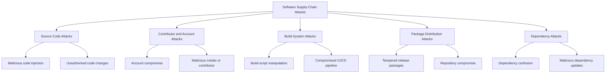

# Figure 2. Taxonomy of Software Supply-Chain Attacks



**Figure 2:** Classification of major software supply-chain attack categories and representative attack techniques.

**Relevance:** The XZ Utils incident illustrates how contributor trust and release/build processes can be abused to introduce malicious functionality into a software distribution.
```
