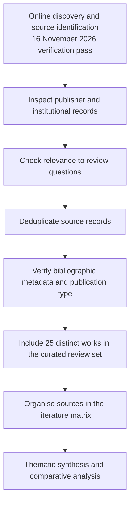

# Figure 1. Literature Selection Process

**Figure 1:** Source identification and curation workflow used for the fresh online verification pass.

**Evidence note:** The historical hit counts from the student's original searches were not available. This figure reports the current curated set of 25 distinct works and does not imply that 25 was the number of search results or full-text records initially identified.
