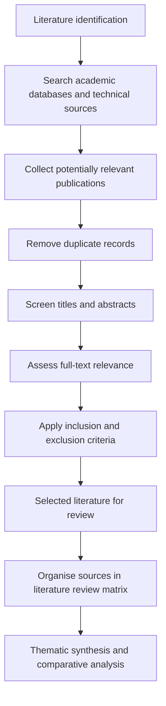

# Figure 1. Literature Selection Process

**Figure 1:** Literature identification, screening, eligibility assessment, and inclusion process.

**Note:** This is a conceptual workflow. Actual screening counts will be added after the search records have been consolidated.
