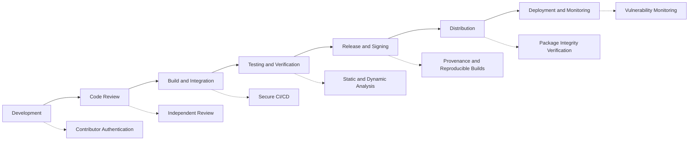

# Figure 3. Software Supply-Chain Security Lifecycle



**Figure 3:** Security checkpoints throughout the software supply-chain lifecycle.

**Relevance:** The XZ Utils incident demonstrates why security controls must extend beyond source-code review to include build systems, release verification, distribution, and monitoring.
```
